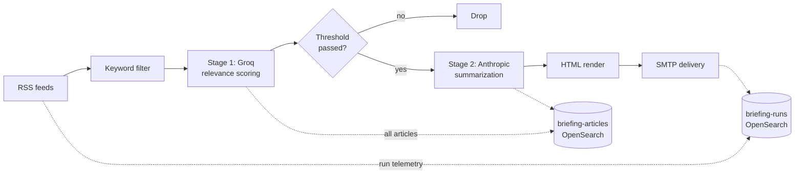

# Smart Briefing

A configurable RSS-to-LLM pipeline that delivers a curated daily briefing to your inbox.

**This isn't another "AI news briefing" tool.** It's a pattern: you bring the feeds and the relevance criteria, the pipeline scores them with a fast/cheap model, summarizes the survivors with a stronger model, and emails you the result. The included example focuses on AI + security news. Climate policy, fashion industry, M&A news, or anything with an RSS feed works the same way.

Built for [n8n](https://n8n.io) + [OpenSearch](https://opensearch.org). Hardened against indirect prompt injection from feed content. Backed by structured telemetry so you can actually see what your pipeline is doing.

---

## What you get

- **One n8n workflow** that ingests RSS feeds, scores articles for relevance, summarizes the survivors, renders an HTML email, and persists everything to OpenSearch.
- **Two-stage hybrid LLM pipeline** — fast/cheap model (Groq) for relevance scoring at volume; stronger model (Anthropic) for the small set of summaries that actually ship.
- **Strict-schema OpenSearch indices** — every run produces a structured `briefing-runs` doc with timing, token counts, errors, and outcome. No black-box pipelines.
- **A working example** — the included AI/security feed configuration runs out of the box. Swap the feeds for yours and the rest is the same.

## What you bring

- An n8n instance (2.19.x or later)
- An OpenSearch cluster (3.x)
- An SMTP account for delivery
- API keys: [Groq](https://groq.com) for Stage 1, [Anthropic](https://www.anthropic.com/api) for Stage 2

The repo ships with a `docker-compose` file for n8n + OpenSearch if you don't already have them running.

---

## Quickstart

```bash
# 1. Clone
git clone https://github.com/sashafelix/smart-briefing-pipeline.git
cd smart-briefing-pipeline

# 2. Configure
cp .env.example .env
# Edit .env — set OPENSEARCH_URL, BRIEFING_FROM_EMAIL, BRIEFING_TO_EMAIL, etc.

# 3. Bring up n8n + OpenSearch
docker compose -f compose/opensearch.yml up -d
docker compose -f compose/n8n.yml up -d

# 4. Apply OpenSearch index templates
./scripts/apply-templates.sh   # POSTs config/index-templates/*.template.json

# 5. Import and configure the n8n workflow
#    a) n8n UI → Workflows → Import from File → n8n/workflows/smart-briefing.json
#    b) Create credentials: OpenSearch admin (HTTP Basic), Groq API (HTTP Header), Anthropic API, SMTP
#    c) Seed the default config:
#       curl -X POST "$OPENSEARCH_URL/briefing-config/_doc/default" \
#            -u admin:$OS_PASS \
#            -H 'Content-Type: application/json' \
#            -d @config/examples/ai-security-news/briefing-config.json
#    d) Activate the workflow
```

You should receive your first briefing within a few minutes of activation (or wait for the scheduled trigger).

---

## How configuration works

The pipeline reads its runtime config from a single OpenSearch document at `briefing-config/_doc/default`. This doc controls:

- **Models** — `stage1_model`, `stage2_model`, temperatures
- **Thresholds** — Stage 1 relevance cutoff (`high` / `medium` / `low`)
- **Sections** — how summarized articles are grouped in the email
- **Window** — how far back to consider articles "fresh"

See [`config/examples/ai-security-news/briefing-config.json`](config/examples/ai-security-news/briefing-config.json) for a working configuration.

**Feeds** are defined as nodes inside the workflow itself in v1. They're public RSS endpoints — swap any of the `rssFeedRead` nodes for your own feeds in the n8n UI. v2 (see Roadmap) introduces a web frontend that makes feeds, models, sections, and schedule editable without touching the workflow.

---

## Architecture



See [`docs/architecture.md`](docs/architecture.md) for the full architecture write-up.

---

## Threat model

Every article ingested is a piece of untrusted content from the open internet. Indirect prompt injection — instructions hidden inside an article body trying to hijack Stage 1 or Stage 2 — is treated as a real threat, not a theoretical one.

The v1 workflow includes baseline mitigations: URL stripping at ingest, content length caps, structured-output parsing with rejection on schema failure, and explicit role boundaries in system prompts.

The full threat model + mitigation rationale ships as `docs/threat-model.md` alongside an upcoming deep-dive post.

---

## Roadmap

| Version | Status | What lands |
|---|---|---|
| **v1.0** | Today | Production-tested workflow, sanitized for OSS release. Hybrid LLM pipeline, strict-schema OpenSearch indices, AI-security sample configuration. Runs daily in production. |
| **v1.1** | 1–2 weeks | In-code prompt-injection mitigations made explicit, formal threat model document |
| **v2.0** | Later | Python pipeline rewrite, web frontend for config-driven everything (feeds, models, sections, schedule), OpenSearch Dashboards, weekly errors report |

Each version pairs with a write-up: v1.0 launch (today), v1.1 prompt-injection deep-dive, v2.0 hybrid LLM cost/quality argument.

---

## Why this exists

Most "AI daily briefing" tools are point solutions: one specific newsletter, one specific topic, one specific format. The interesting part isn't the briefing — it's the pattern underneath. A configurable pipeline that takes any RSS feed set + any relevance criteria + any output format and ships a curated daily summary, with observability good enough to actually debug when things go wrong.

This repo is that pattern, with a working AI/security example to prove it.

---

## License

MIT. See [LICENSE](LICENSE).

---

## Status

Production-tested. This pipeline runs daily in the author's homelab and has been the source of the author's morning briefing for months. Issues and pull requests welcome.
