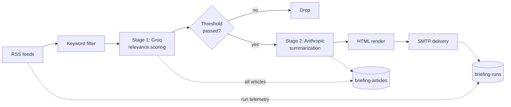

# Smart Briefing

A configurable RSS-to-LLM pipeline that delivers a curated daily briefing to your inbox.

**This isn't another "AI news briefing" tool.** It's a pattern: bring your feeds and relevance criteria, the pipeline scores them with a fast/cheap model, summarizes the survivors with a stronger model, and emails you the result. The included example focuses on AI + security news. Climate policy, fashion industry, M&A, or anything with an RSS feed works the same way.

Built for [n8n](https://n8n.io) + [OpenSearch](https://opensearch.org). Hardened against indirect prompt injection from feed content. Backed by structured telemetry so you can actually see what your pipeline is doing.

Runs on Linux, macOS, and Windows.

---

## Quickstart

```bash
git clone https://github.com/sashafelix/smart-briefing-pipeline.git
cd smart-briefing-pipeline

# 1. Configure
cp .env.example .env
# Edit .env — fill in every value marked CHANGE_ME.

# 2. Bring up the full stack (opensearch + postgres + n8n)
docker compose up -d

# 3. Wait for OpenSearch to be healthy (~60-90s on first run)
docker compose ps   # opensearch status should read "healthy"

# 4. Apply OpenSearch index templates + seed the sample config:
#    Linux / macOS:
./scripts/apply-templates.sh && ./scripts/seed-config.sh
#    Windows PowerShell:
.\scripts\apply-templates.ps1 ; .\scripts\seed-config.ps1
```

Then **[docs/setup.md](docs/setup.md)** — import the workflow into n8n, create the 4 credentials, activate. The n8n side can't be scripted (credentials enter through the UI), so this part is manual but quick.

---

## Configuration

The pipeline reads runtime config from a single OpenSearch document at `briefing-config/_doc/default` — models, thresholds, window, keywords. Edit and re-run `seed-config` to change behaviour; no restart needed.

See [`config/examples/ai-security-news/`](config/examples/ai-security-news/) for a working configuration and customization guide.

---

## Architecture



Two-stage hybrid LLM pipeline backed by three strict-schema OpenSearch indices. Full write-up in [`docs/architecture.md`](docs/architecture.md).

**Optional — OpenSearch Dashboards** for visual exploration of articles, runs, and config. Uncomment the `opensearch-dashboards` block in `docker-compose.yml` and run `docker compose up -d`. UI at [http://localhost:5601](http://localhost:5601).

---

## Threat model

Every article is untrusted content from the open internet. Indirect prompt injection is treated as a real threat. See [`docs/threat-model.md`](docs/threat-model.md) for the v1 baseline mitigations and the deep-dive write-up.

---

## Roadmap

| Version | When | What |
|---|---|---|
| **v1.0** | Today | Production-tested workflow, hybrid LLM pipeline, strict-schema indices, AI-security sample config |
| **v1.1** | 1–2 weeks | Explicit in-code prompt-injection mitigations, formal threat model doc |
| **v2.0** | Later | Python rewrite, web frontend for config-driven everything, OpenSearch Dashboards, weekly errors report |

---

## License & status

MIT ([LICENSE](LICENSE)). Production-tested — runs daily in the author's homelab. Issues and PRs welcome.