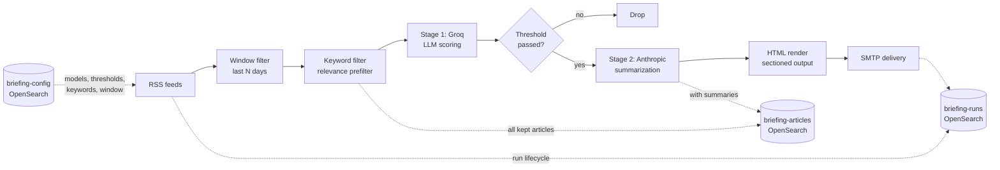

# Architecture

Smart Briefing is a two-stage RSS-to-LLM pipeline. This document covers the runtime pipeline, the storage layer, and the rationale behind the hybrid LLM split.

## Pipeline



Five distinct stages:

1. **Ingest.** A scheduled trigger fires the workflow at the configured time. Each RSS source is fetched in parallel and tagged with `source_name` and `source_type`. All articles flow into a single stream.
2. **Window + keyword filter.** Articles older than `window_days` (from `briefing-config`) are dropped. The remaining articles pass a deterministic keyword filter — fast, free, removes obviously off-topic content before any LLM call.
3. **Stage 1 — relevance scoring.** Batches of 10 articles go to a fast/cheap model (Groq, default `gpt-oss-120b`) which returns a `relevance` label (`high` / `medium` / `low`) and a `relevance_score` for each. Articles below the configured threshold are dropped.
4. **Stage 2 — summarization.** Each surviving article gets one call to a stronger model (Anthropic, default `claude-haiku-4-5`) for a 2–3 sentence technical summary. This is the small, expensive set.
5. **Render + deliver.** Summarized articles are grouped by relevance band, rendered into a sectioned HTML email, and delivered via SMTP.

## Storage

Three OpenSearch indices, all with strict-schema mappings:

```mermaid
flowchart TB
    subgraph briefing-config
        C[_id: 'default'<br/>models, thresholds,<br/>keywords, window]
    end
    subgraph briefing-articles
        A1[_id: sha256(url)<br/>title, content, summary,<br/>relevance, source, models]
        A2[per-article history]
    end
    subgraph briefing-runs
        R[_id: 'YYYY-MM-DD'<br/>status, counts, timing,<br/>tokens, errors, email]
    end

    C -.->|read at start| A1
    A1 -.->|aggregate| R
```

- **`briefing-config`** holds a single document at `_id='default'` with runtime configuration. The workflow reads this on every run, so config changes take effect on the next run with no redeploy.
- **`briefing-articles`** is the per-article history. The document ID is a hash of the canonical URL, so re-running a workflow against overlapping windows naturally deduplicates. Updates use `index` semantics — articles are upserted with `first_seen_run_id` preserved and `last_seen_run_id` rolling forward.
- **`briefing-runs`** is one document per run, keyed by date. Captures the lifecycle (`started_at` → `completed_at` → `email_sent_at`), counts at each stage, latency, token usage, and any errors. This is what makes the pipeline observable — every run produces a structured artifact you can query.

All three indices use `dynamic: strict` so unknown fields raise errors loudly rather than drifting silently. The index templates are in [`config/index-templates/`](../config/index-templates/) and applied by [`scripts/apply-templates.sh`](../scripts/apply-templates.sh).

## Why the hybrid LLM split

The pipeline uses two different model providers for two different reasons.

**Stage 1 is a routing decision.** For 100+ articles a day, you need a fast model with a cheap-per-token cost and a reliable structured-output contract. Groq's hosted `gpt-oss-120b` is currently the right tool: low latency, low cost, good enough at "is this article relevant to my interests" classification. Quality matters less here than throughput — getting routing wrong wastes a few cents on Stage 2, getting it slow wastes the whole pipeline.

**Stage 2 is the output the user actually reads.** Once routing has narrowed 100 articles down to ~20 summarization targets, this is the small, high-leverage set where quality matters. Anthropic's Claude Haiku has the right combination of writing quality, brevity, and cost-per-call for short technical summaries.

Splitting these means the heavy spend goes where it's visible (the summaries you read) and the light spend goes where it isn't (the routing decision behind the scenes). A single-model pipeline either overpays for routing or underdelivers on summaries.

This split is documented as ADR-0018 in the author's homelab; a deeper write-up arrives with v2.0.

## Sequencing and idempotency

Two properties worth calling out:

**Same-day re-trigger is safe.** The `briefing-runs._id` is the date string, so re-triggering today's workflow updates the same run doc rather than creating a new one. The wrapper "Mailer" step (separate workflow) checks `email_sent: true` before sending — same-day re-runs don't generate duplicate emails. The `briefing-articles` index uses URL-hash IDs, so re-runs don't create duplicate article docs either.

**Failure modes are surfaced, not swallowed.** Stage 1 and Stage 2 emit per-batch errors (LLM provider errors, JSON parse failures, score-to-article mismatch) into the run doc's `errors[]` array. A run with errors still completes and delivers what it has — the errors are visible after the fact rather than crashing the pipeline.

## Future work (v2)

The v2 rewrite (tracked separately) moves the pipeline from n8n to a Python service, adds a web frontend for editing configuration without YAML wrangling, and introduces OpenSearch Dashboards for run observability. The OpenSearch schemas above are forward-compatible — v2 reads and writes the same indices.
